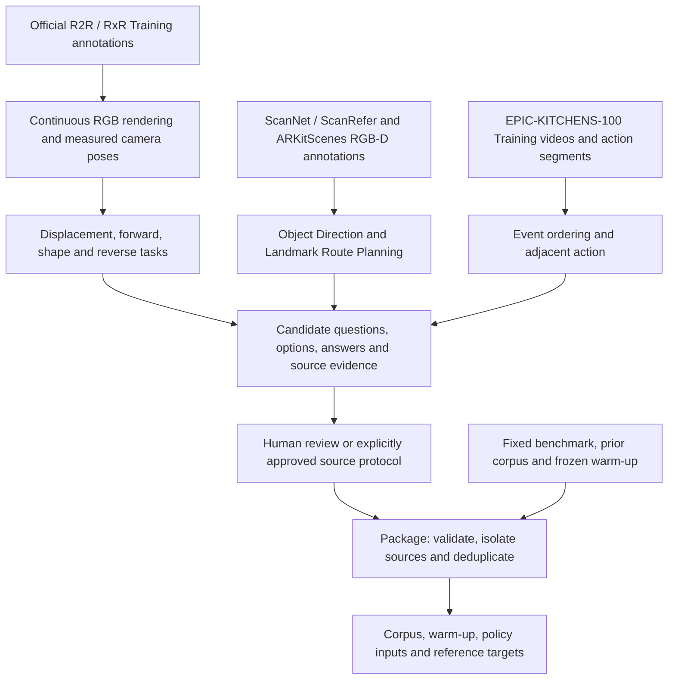

# VideoVera

**Verifiable Process Reward for Video Reasoning**

This repository contains the data-construction pipeline for VideoVera. Existing
video annotations determine questions, answer choices, correct answers and
reference reasoning claims. The generators retain continuous source video and
record the geometry, poses or temporal segments used to derive each example.

This release focuses on data generation and acceptance. It does not include
training runs, checkpoints, experimental results, benchmark result analysis,
error analysis, paper figures or cluster-specific job controllers.

## Tasks and annotation sources

| Task | Command | Source annotations |
|---|---|---|
| Object Direction | `object-direction-scannet`, `object-direction-arkit` | ScanNet/ScanRefer objects and instance masks; ARKitScenes object boxes, RGB-D and poses |
| Egocentric Displacement | `displacement` | R2R/RxR routes, continuous Matterport3D rendering and measured camera poses |
| Forward Route Planning | `route-tasks --task route_plan` | Measured forward actions and visually grounded route landmarks |
| Landmark Route Planning | `landmark-routes` | ARKitScenes object boxes, depth support, camera trajectory and continuous RGB |
| Route-Shape Classification | `route-tasks --task route_shape` | Complete measured motion/turn sequence |
| Reverse Route Planning | `route-tasks --task reverse_route_plan` | Forward route, inverse actions and reversed temporal order |
| Event-Sequence Ordering | `temporal --task event_order` | EPIC-KITCHENS-100 Training action segments |
| Adjacent Action | `temporal --task before_or_after_action` | EPIC-KITCHENS-100 Training action segments and their neighbors |

Public module and command names describe their purpose rather than historical
experiment versions. Stable task keys and serialized schema identifiers are
retained so existing dataset records remain readable.

## Training datasets

The frozen training releases are available on Hugging Face:

| Release | Total examples | Warm-up SFT | RL prompts |
|---|---:|---:|---:|
| [VideoVera-6.4k](https://huggingface.co/datasets/YilingMa/VideoVera-6.4k) | 6,400 | 800 | 5,600 |
| [VideoVera-12k](https://huggingface.co/datasets/YilingMa/VideoVera-12k) | 12,431 | 1,600 | 10,831 |
| [VideoVera-27k](https://huggingface.co/datasets/YilingMa/VideoVera-27k) | 27,229 | 1,600 | 25,629 |

Each release includes video payloads, frozen training partitions, separate RL
inputs and reference targets, checksums and a download/preparation guide. The
12k and 27k releases share the same 1,600-example warm-up file byte-for-byte and
unchanged warm-up videos. The 6.4k release retains its original 800-example
warm-up partition. See each dataset card for task counts and exact file formats.

## Install

Python 3.10 or later, FFmpeg and FFprobe are required.

```bash
git clone https://github.com/Yiling-Ma/VideoVera.git
cd VideoVera
python -m venv .venv
source .venv/bin/activate
python -m pip install -e '.[geometry]'
videovera --help
```

Continuous Matterport3D rendering additionally requires a compatible
Habitat-Sim installation and locally licensed scene assets. Install the
`navigation` extra in that environment. Habitat-Sim is a separate, platform-
dependent installation; it is not replaced by a generic panorama renderer.

```bash
python -m pip install -e '.[navigation]'
```

Source datasets, their access credentials and model weights are **not** included.
Acquire each source through its official distribution under its own terms.
See [source preparation](docs/sources.md) and the complete
[generation recipe](docs/generation.md).

## How to use `data_generator`

Run the commands below from the repository root after installation. The examples
use `python -m data_generator`; the installed `videovera` command accepts the same
subcommands and arguments. Run only the branches required for your tasks.



### 1. Prepare local inputs

Acquire the required official Training assets and edit the source manifests using
[the source preparation guide](docs/sources.md). A typical local layout is:

```text
inputs/
  benchmark.jsonl                  # Fixed held-out benchmark; includes usable video paths
  official_source_registry.json    # Official split and physical source identities
  r2r_train.json.gz                # Official R2R Training route annotations
  matterport3d/                    # Licensed scenes and navigation meshes
  scannet/
    scans/
    scanrefer/ScanRefer_filtered_train.json
  arkitscenes/Training/             # RGB, depth, intrinsics, trajectories and 3D boxes
  arkit_train_sources.json          # Scan directories and official physical visit IDs
  EPIC_100_train.csv
  epic/                            # Original recordings named by video ID
  displacement_pilot_reviews.jsonl # At least five accepted displacement pilot reviews
  human_reviews.jsonl              # Actual candidate/sample review decisions
  accepted_corpus.jsonl            # Optional previously accepted corpus
  accepted_reference_targets.jsonl # Original targets for that corpus, when stored separately
  frozen_warmup.jsonl              # Warm-up partition to preserve exactly
work/                              # Generated candidates, media and export artifacts
```

Not every task needs every source: temporal tasks only need EPIC inputs, while
Object Direction can use ScanNet/ScanRefer or ARKitScenes. The benchmark and
source registry used for final packaging must cover the relevant source groups.

Use `configs/arkit_sources.example.json` and
`configs/source_registry.example.json` as format templates; replace all
placeholders with official identities. ARKitScenes scans of the same physical
visit must share a visit ID. These templates are not pre-approved source lists.

### 2. Prepare navigation parents

This branch supplies the continuous videos and measured poses used by
Egocentric Displacement, Forward Route Planning, Route-Shape Classification and
Reverse Route Planning. It requires the navigation dependencies and Habitat-Sim.

First enumerate routes from the official Training annotations:

```bash
python -m data_generator annotation-routes \
  --episodes inputs/r2r_train.json.gz \
  --benchmark inputs/benchmark.jsonl \
  --output-dir work/annotation_routes \
  --shards 1 --max-legs 6
```

Then render valid navigation parents:

```bash
python -m data_generator render-routes \
  --input-dir work/annotation_routes/shard_00 \
  --scenes-dir inputs/matterport3d \
  --output-dir work/navigation_parents \
  --count 5000 --speed-scale 0.35 --max-legs 6 \
  --max-near-black-ratio 0.10 --seed 20260928
```

The annotation command writes into shard directories, including `shard_00` when
`--shards 1` is used. The renderer reads `.actions.json` files directly from the
specified shard, not from its parent directory. Its output includes
`manifest.json`, continuous videos and corresponding measured-pose sidecars.

The requested count is an example production budget, not a guarantee of source
capacity or an accepted-data count. The later task selectors may require more
valid parents. Use a new output directory for a different rendering run and do
not change labels or relax gates to fill a shortfall. RxR guide/follower Training
annotations use the same annotation command with the appropriate
`--dataset-name` and separate output directories.

Forward Route Planning additionally needs visually grounded landmark labels.
With a local Qwen3-VL-8B-Instruct endpoint already running:

```bash
python -m data_generator landmarks \
  --dataset-dir work/navigation_parents \
  --model Qwen/Qwen3-VL-8B-Instruct \
  --base-url http://127.0.0.1:8000/v1 \
  --min-confidence 0.70
```

This command is a model client; it does not launch a model server. The observation
model supplies landmark labels, while measured pose rules determine route
answers and reference actions.

### 3. Generate candidates for the selected tasks

**Forward Route Planning**

```bash
python -m data_generator route-tasks --task route_plan \
  --source work/navigation_parents --output work/route_plan \
  --count-per-task 1000
```

**Route-Shape Classification and Reverse Route Planning**

Check the original balanced selection before producing clips:

```bash
for task in route_shape reverse_route_plan; do
  python -m data_generator route-tasks --task "$task" \
    --source work/navigation_parents --output "work/$task" \
    --count-per-task 4000 --seed 20261003 --workers 2 --plan-only
done
```

If both plans pass, run the same commands without `--plan-only` to generate and
finalize the candidates:

```bash
for task in route_shape reverse_route_plan; do
  python -m data_generator route-tasks --task "$task" \
    --source work/navigation_parents --output "work/$task" \
    --count-per-task 4000 --seed 20261003 --workers 2
done
```

Each task retains the original class/answer-letter balancing, unique source
windows and cap of five clips per parent. The 4,000-record buffers are candidates;
formal acceptance and deduplication can reduce the final count.

**Egocentric Displacement**

```bash
python -m data_generator displacement \
  --source-dir work/navigation_parents \
  --scenes-dir inputs/matterport3d \
  --pilot-labels inputs/displacement_pilot_reviews.jsonl \
  --output-dir work/displacement --count 3200 --seed 20261002
```

The pilot file must contain at least five actual accepted reviews, including
correct-answer and correct-reasoning decisions. The planner requires distinct
measured routes and balances directions, reference endpoints and answer letters.
It reports insufficient capacity rather than counting variants as unique routes.

**Object Direction — ScanNet/ScanRefer**

```bash
python -m data_generator object-direction-scannet pool \
  --root inputs/scannet --benchmark inputs/benchmark.jsonl \
  --output-dir work/scannet_direction --target 300 \
  --per-scene 10 --min-unique-categories 3 --max-scenes 100
```

**Object Direction — ARKitScenes**

```bash
python -m data_generator object-direction-arkit \
  --source-manifest inputs/arkit_train_sources.json \
  --benchmark inputs/benchmark.jsonl \
  --output-dir work/arkit_direction --count 300 \
  --max-per-physical-scene 10
```

These branches retain the original observer/facing/target geometry, referent
uniqueness, visual support, connected co-visibility and target-extent checks.
ARKitScenes additionally uses calibrated measured-depth support.

**Landmark Route Planning**

```bash
python -m data_generator landmark-routes \
  --data-root inputs/arkitscenes/Training \
  --benchmark inputs/benchmark.jsonl \
  --output-dir work/landmark_routes --target 1000 \
  --max-per-scene 14 --video-fps 10 --seed 20261002
```

The generator searches strictly observed objects and continuous source windows.
Final packaging applies the cap of 14 across scans of the same physical visit,
including previously accepted examples.

**Event-Sequence Ordering and Adjacent Action**

```bash
python -m data_generator temporal --task event_order \
  --annotations inputs/EPIC_100_train.csv --video-root inputs/epic \
  --benchmark inputs/benchmark.jsonl \
  --output-dir work/event_order --count 2000

python -m data_generator temporal --task before_or_after_action \
  --annotations inputs/EPIC_100_train.csv --video-root inputs/epic \
  --benchmark inputs/benchmark.jsonl \
  --output-dir work/adjacent_action --count 2400
```

When supplementing a temporal pool, pass earlier raw candidates through
`--existing` to exclude used event windows or anchor/neighbor pairs before
regeneration. Required actions must survive the uniform 24-frame model view.

### 4. Review candidates

Inspect the original continuous videos, questions, choices, answers and retained
geometry/temporal evidence. Record each review as one JSON object per line in
`inputs/human_reviews.jsonl`; `configs/review.template.json` shows the fields.
Individual acceptance requires `decision=accept`, `video_quality=pass`,
`question_unique=yes`, `gold_answer_correct=yes` and `gold_reasoning_correct=yes`.
Blank or incomplete decisions do not grant approval.

Bulk admission can instead use an explicitly approved source/task protocol after
concrete sample review. The approval must identify the reviewed samples, match
the exact quality-policy hash and authorize bulk generation and admission after
checks. It does not claim that every generated example was individually reviewed.
See [the approval format](docs/acceptance.md#reviewed-source-protocol-approval).

### 5. Validate, deduplicate and export

The example below extends an existing corpus while preserving its original
warm-up partition. Include only candidate files produced by your selected
branches; `--candidates` can be repeated.

```bash
python -m data_generator package \
  --candidates work/scannet_direction/scannet_spatial_candidates.jsonl \
  --candidates work/arkit_direction/candidates.jsonl \
  --candidates work/route_plan/route_plan.jsonl \
  --candidates work/route_shape/route_shape.jsonl \
  --candidates work/reverse_route_plan/reverse_route_plan.jsonl \
  --candidates work/displacement/qa_candidates.jsonl \
  --candidates work/landmark_routes/qa_candidates.jsonl \
  --candidates work/event_order/candidates.jsonl \
  --candidates work/adjacent_action/candidates.jsonl \
  --benchmark inputs/benchmark.jsonl \
  --source-registry inputs/official_source_registry.json \
  --review-labels inputs/human_reviews.jsonl \
  --existing inputs/accepted_corpus.jsonl \
  --existing-targets inputs/accepted_reference_targets.jsonl \
  --warmup inputs/frozen_warmup.jsonl \
  --output-dir work/dataset_release
```

For a source-protocol approval, additionally supply
`--source-approvals inputs/source_approvals.json` and
`--quality-policy configs/quality_policy.json`. The source registry must cover
candidates, prior corpus records and the benchmark using official source/physical
identities. Existing records need their original reference targets, either in
the records themselves or in `--existing-targets`.

For a fresh corpus, omit `--existing` and `--existing-targets`, and supply a frozen
warm-up file selected from the reviewed records in that build. Warm-up IDs must
be a unique subset of the resulting corpus, and their task, answer and message
content must match. The exporter preserves that file's bytes; it does not
silently choose or reshuffle a warm-up split.

Packaging checks reference schema and reward-one validity, official Training
membership, benchmark physical-source isolation, full media decode, decoded
content/QA slots, source semantics and the combined existing/new caps.

### 6. Inspect the actual outputs

```text
work/dataset_release/
  corpus.jsonl               # Existing prefix plus accepted new records
  accepted_new.jsonl         # Newly accepted records with typed references
  warmup.jsonl               # Byte-identical copy of the supplied frozen warm-up
  policy.jsonl               # Non-warm-up model inputs, without answers or targets
  references.jsonl           # Hidden reference targets in the same order as policy.jsonl
  rejections.json            # Rejected candidate IDs and reasons
  acceptance_progress.json   # Durable acceptance progress
  manifest.json              # Actual accepted counts, per-task counts and input hashes
```

Use `manifest.json` to report dataset size. Requested counts, downloaded scans,
rendered parent videos and generated candidates are not accepted-example counts.
The full export contract is described in [acceptance and formats](docs/acceptance.md).

Keep the same inputs and configuration when resuming a supported stage. Use new
output directories for changed tasks or configurations, retain rejection and
partial-output records, and use a new directory for each final package export.
These commands do not start model training or upload the dataset.

## Layout

```text
data_generator/
  data/
    navigation/        # Annotation routes, rendering, pose actions and landmarks
    routes/            # Forward, shape and reverse task generation
    displacement/      # Endpoint-frame geometry and balanced route selection
    object_direction/  # ScanNet and ARKitScenes spatial candidates
    landmark_routes/   # Depth-supported objects and continuous route windows
    temporal/          # Event ordering and adjacent-action candidates
  sources/             # Official annotation readers and geometry utilities
  formats/             # Messages, options and typed reference construction
  validation/          # Full decode, schema and reference agreement checks
  packaging.py         # Acceptance, isolation, deduplication and split export
configs/               # Source/review templates and quality policy
docs/                  # Installation, generation and export contracts
```

## Quality and split contracts

- Object Direction uses explicit observer/facing/target roles, signed horizontal
  projections, referent uniqueness, target-extent margins and visual support.
- Route labels come from measured camera poses. Initial or terminal looks are
  distinguished from actual path bends. Shape labels and reverse actions are
  computed without relabeling clips to satisfy quotas.
- Landmark routes retain one continuous original RGB interval, calibrated poses,
  depth-supported visibility and uniform model-frame support. Dense window
  search expands coverage without changing candidate quality tests.
- Temporal examples use distinct annotated actions, unambiguous time order and
  at least two uniform model samples per required action.
- Packaging checks identifiers, physical source groups, full media decoding,
  uniform decoded-frame content, QA slots, source semantics and reference validity.
  Physical scene IDs are required; rescans do not create additional scene capacity.
- Object Direction is capped at 10 examples per physical scene; Landmark Route
  Planning at 14. Shape/reverse selection retains at most five clips per parent.
- Frozen warm-up membership and bytes are preserved. Policy exports contain no
  answers, reference traces, verifier state or assistant messages.

See [acceptance and formats](docs/acceptance.md) for exact inputs and outputs.
No model training or recurring background process is launched by these commands.

## Installation checks

```bash
videovera --help
python -m data_generator --help
```

The Python package is `data_generator`; the installed command remains
`videovera`. Core rules were checked against the production implementation.
Private regression checks cover geometry, media and export invariants; the
regression suite is not included in this public repository. Real-data generation
requires the licensed source assets and a compatible Habitat-Sim environment.

## Source acknowledgements

The pipeline reads annotations from ScanNet, ScanRefer, ARKitScenes,
Matterport3D, R2R, RxR and EPIC-KITCHENS-100 and uses Habitat-Sim for continuous
navigation rendering. These datasets and dependencies retain their own licenses
and citation requirements. Dataset assets and third-party model weights are not
redistributed by this code repository.
